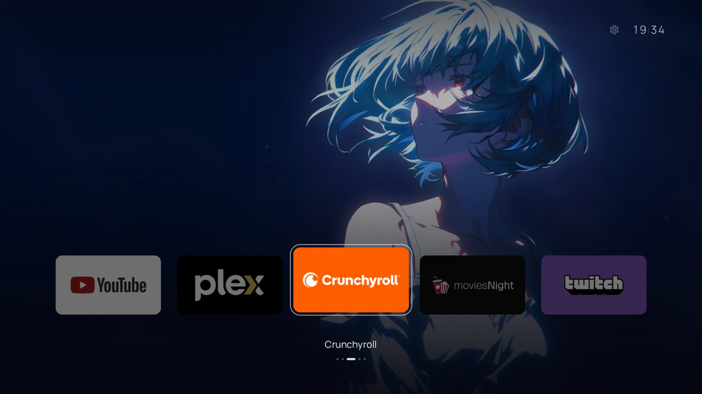
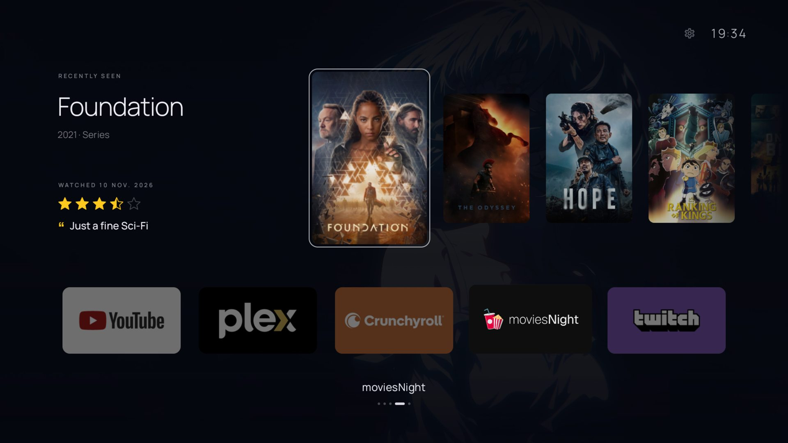
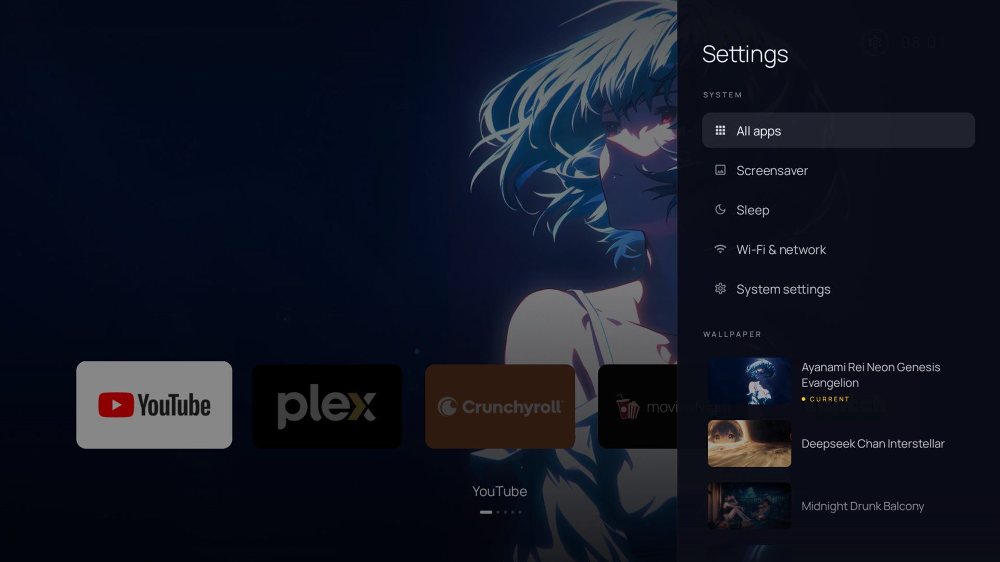

# Still

A quiet home screen for the NVIDIA SHIELD TV Pro: one row of apps over a live video
wallpaper, a small clock, and a "Recently seen" strip from my
[moviesNight](https://movies.juliuszlioba.com/) site.



Built for my own SHIELD TV Pro (2019, Android 11) to replace Projectivy and the stock
Google TV launcher. It has no ads, no recommendation rows and nothing to configure
beyond a wallpaper.

## Features

**One row of apps.** YouTube, Plex, Crunchyroll, moviesNight and Twitch, each shown with
the official TV banner the app ships. The selected app lifts slightly inside a thin
rounded ring; the others stay dimmed. Its name and a small position indicator sit
underneath.

**Recently seen.** When moviesNight is selected, the ten newest entries from the
moviesNight database appear above the row: poster, title, year, type, date watched, star
rating and my one-line comment. Choosing a poster opens that title's detail screen in the
moviesNight TV app. The last card, "More on moviesNight", opens the app itself.



**Settings drawer.** The faint gear next to the clock slides in a drawer from the right:

- **System:** All apps (see [Known limitations](#known-limitations)), Screensaver (starts
  Ambient Mode now), Sleep, Wi-Fi & network and System settings.
- **Wallpaper:** every `Pictures/live-wallpaper-N` folder on the SHIELD, with a thumbnail
  and a tidied file name. The choice is remembered.



**Live wallpaper.** A muted, looping video (or a still image) fills the background and
drifts a little as you move along the row. It stops while another app is open, so the 4K
decoder is free for Plex or YouTube, and fades back in when you return.

## Remote controls

| Where | Key | Does |
|---|---|---|
| App row | ← → | Move between apps |
| App row | OK | Open the app |
| App row | ↑ | To the posters (on moviesNight) or to the gear |
| Posters | ← → | Move through Recently seen |
| Posters | OK | Open that title in moviesNight |
| Posters | ↓ or Back | Back to the app row |
| Gear | OK | Open the settings drawer |
| Drawer | ↑ ↓ | Move (the list scrolls) |
| Drawer | OK | Run the action or choose the wallpaper |
| Drawer | ← or Back | Close the drawer |
| Anywhere | Home | Back to the app row |

## Repository

| Folder | What's in it |
|---|---|
| `launcher/` | The Android TV app: Kotlin, Jetpack Compose, Media3 ExoPlayer, supabase-kt, Coil |
| `mockups/` | HTML design mockups, opened straight in a browser. `mockup-a-still.html` is the approved design the app follows. Their video background is `assets/live-wallpaper.mp4`, which is git-ignored: drop any video there |
| `docs/` | Screenshots used in this README |
| `assets/` | The moviesNight banner used by the mockups. Wallpapers stay local and are git-ignored |
| `info/` | Notes on the SHIELD itself: app audit and debloat record |
| `licenses/` | Licenses of bundled third-party files (the Manrope font) |

## Setup

This is a personal launcher: the app row and the moviesNight integration are specific to
my setup. See [Adapting it](#adapting-it) to use it with other apps.

### Requirements

- An Android TV device on Android 9 or newer. It was built and tested on a SHIELD TV Pro
  (2019) running Android 11.
- Android Studio (for its JDK and the Android SDK), and `adb` connected to the TV:
  enable network debugging on the TV, then run `adb connect <tv-ip>:5555`.
- The moviesNight Supabase project (URL and publishable key) for Recently seen.

### Build and install

```sh
cd launcher
cp local.properties.example local.properties   # fill in the SDK path and the Supabase URL and key
JAVA_HOME="/c/Program Files/Android/Android Studio/jbr" ./gradlew assembleRelease
adb install -r app/build/outputs/apk/release/app-release.apk
adb shell pm grant com.still.launcher android.permission.READ_EXTERNAL_STORAGE
```

`local.properties` is git-ignored. The release build is signed with the local debug key,
which is fine for a sideloaded personal app.

### Make it the home screen

```sh
adb shell cmd package set-home-activity com.still.launcher/.MainActivity
```

The Home button then opens Still. If an accessibility service (Projectivy, Button Mapper)
remaps Home, turn that remapping off. To go back to another launcher, run the same command
with its home activity, for example Projectivy's:

```sh
adb shell cmd package set-home-activity com.spocky.projengmenu/.ui.home.MainActivity
```

### Wallpapers

Create one folder per wallpaper in the SHIELD's shared storage,
`Pictures/live-wallpaper-1`, `Pictures/live-wallpaper-2` and so on, each holding a video
(`mp4`, `mkv`, `webm`, `mov`) or an image (`jpg`, `png`, `webp`). The easiest way is
SHIELD's "Transfer files over local network" share.

Files copied over that share skip Android's media index, and on Android 11 an app only
sees indexed files in shared storage. The launcher therefore asks Android to index
`Pictures` each time the home screen appears, so a new folder shows up in the drawer on
the next visit.

### moviesNight

Recently seen reads the ten newest rows of the `records` table, newest `watchedat` first,
with the same publishable key as the moviesNight website and TV app. Row-level security
only allows public reads. Posters come from TMDB.

Opening a title directly needs the moviesNight TV app at versionCode 8 or newer, which
reads the Long extra `com.moviesnight.tv.extra.RECORD_ID` on its `MainActivity`. Older
builds just open on their home screen.

## Adapting it

- **Apps in the row:** edit `ROW_PACKAGES` in
  [`LauncherApps.kt`](launcher/app/src/main/java/com/still/launcher/data/LauncherApps.kt),
  and the matching `<package>` entries in
  [`AndroidManifest.xml`](launcher/app/src/main/AndroidManifest.xml) (Android 11 package
  visibility). Apps that aren't installed are skipped.
- **Recently seen:** it only appears when the app with package `com.moviesnight.tv` is
  selected and records load. Without a Supabase project, leave the moviesNight package out
  of the row.
- **Layout:** everything is laid out in the mockup's 1920×1080 pixels (`px()` in
  [`Design.kt`](launcher/app/src/main/java/com/still/launcher/ui/Design.kt)) and scaled to
  the screen, so values match `mockups/mockup-a-still.html` one to one.

## Known limitations

- **All apps** opens the stock Android TV launcher's "Your apps" grid. If that launcher is
  disabled, it opens whichever app handles "all apps" (Projectivy's All apps panel, when
  it's installed), and failing that, the Apps list in Settings.
- **Sleep** opens TV Settings' `PowerSettingsActivity`, which puts the SHIELD to sleep
  straight away. Other Android TV devices may behave differently.
- **The remote's ≡ (Menu) button** is taken by the system on the SHIELD before apps see it,
  so the drawer opens from the gear only.
- **Video backgrounds** play muted, with audio decoding disabled. Very high-bitrate files
  can take a moment to start; the wallpaper fades in on its first frame.

## Credits

- [Manrope](https://github.com/googlefonts/manrope) font, SIL Open Font License 1.1, see
  [`licenses/Manrope-OFL.txt`](licenses/Manrope-OFL.txt).
- App names, logos and banners belong to their owners. The launcher shows the banners each
  installed app provides.
- Posters and title data come from [TMDB](https://www.themoviedb.org/), through the
  moviesNight database. This product uses TMDB images but is not endorsed or certified by
  TMDB.
- The wallpapers in the screenshots are third-party live wallpapers and are not part of
  this repository.

## License

[MIT](LICENSE) for the code in this repository. Bundled third-party files keep their own
licenses (see `licenses/`).

## Acknowledgments

This app was built with the help of AI coding tools. I used [T3 Code](https://t3.codes/) as my main application throughout development. AI made it possible to bring this dream project to life in almost no time, even though I have very little knowledge of Android development.